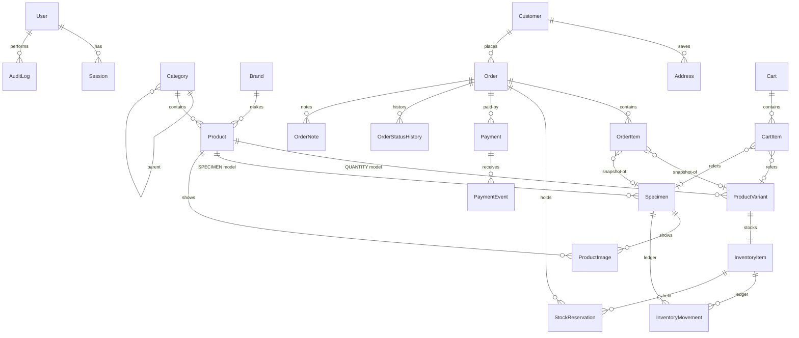

# Deliverable 8 — Database Architecture

PostgreSQL 16+ · Prisma ORM · all money in **integer cents (SGD)** · all timestamps `timestamptz` (UTC, displayed in `Asia/Singapore`) · primary keys `cuid2` strings · human-readable numbers (order no., specimen ID) are separate unique columns.

## 1. Key modelling decisions

1. **Two inventory models, one catalogue.** `Product.inventoryModel` is `QUANTITY` or `SPECIMEN`.
   - `QUANTITY` products have ≥1 `ProductVariant` (a single-option product gets one default variant), and each variant has an `InventoryItem` (on hand / reserved).
   - `SPECIMEN` products act as the **species template** (name, care profile, description). Each physical piece is a `Specimen` row with its own code, price, photos and status.
2. **Specimen status is the lock.** Selling, reserving and releasing a specimen are single conditional `UPDATE … WHERE status = '…'` statements inside a transaction, so two customers can never both reserve or buy the same piece. A unique `soldOrderItemId` acts as a second safeguard.
3. **Order status, payment status and fulfilment status are three separate columns**, each with its own history.
4. **Order items are immutable snapshots**: name, variant, specimen code, SKU, image and unit price are copied at checkout. Later product edits never change historical orders.
5. **Customers are separate from admin users.** Staff live in Better Auth's `User`, and customers are their own `Customer` records (guest checkout, no login in v1). This keeps admin authentication isolated from customer data.
6. **Ledgers are append-only:** `InventoryMovement`, `PaymentEvent`, `OrderStatusHistory`, `AuditLog`. They are never updated or deleted by the application.
7. **Order addresses and contact details are snapshotted onto the order** (the customer's saved addresses can change).

## 2. Entity-relationship diagram



## 3. Entities

### Identity and access
| Entity | Key fields | Notes |
|---|---|---|
| `User` | id, email (unique), name, **role** (`DEVELOPER`/`OWNER`/`STAFF`), status (`ACTIVE`/`DISABLED`), twoFactorEnabled, lastLoginAt | Better Auth core table, extended with role. Only staff/admin |
| `Session`, `Account`, `Verification`, `TwoFactor` | Better Auth standard tables | Generated by the Better Auth Prisma adapter |
| **Roles** | `enum Role` + `Setting['staffPermissions']` (JSON toggles for "configurable" permissions) | Three fixed roles keep RBAC simple and auditable; the permission matrix lives in code (`src/modules/auth/permissions.ts`) |

### Catalogue
| Entity | Key fields |
|---|---|
| `Category` | id, parentId?, name, slug (unique per parent), description, bannerImageId?, sortOrder, enabledFilters (JSON), isLivestock (default for products), status |
| `Brand` | id, name, slug |
| `Product` | id, categoryId, brandId?, name, slug (unique), scientificName?, **inventoryModel**, isLivestock, status (`DRAFT`/`PUBLISHED`/`ARCHIVED`), descriptionJson, highlights[], specs (JSON key-values), **careProfile** (JSON: lighting, flow, placement, difficulty, growth, reefSafe, temperament, diet, maxSizeCm, minTankL), colourTags[], maxPerOrder?, collectionOnly, featured, seoTitle?, seoDescription?, searchVector (tsvector), publishedAt, timestamps |
| `ProductVariant` | id, productId, name ("22 kg"), optionValues (JSON), sku (unique), **priceCents**, compareAtPriceCents?, costCents?, sortOrder, status |
| `ProductImage` | id, **productId? / specimenId?** (exactly one, enforced by a CHECK), r2KeyBase, width, height, dominantColour, blurDataUrl, altText, sortOrder, isPrimary, isRepresentative |

### Unique livestock
| Entity | Key fields |
|---|---|
| `Specimen` | id, **code** (unique, `CF-SPS-0142`), productId (species template), **priceCents**, costCents?, **status** (`DRAFT`/`AVAILABLE`/`RESERVED`/`SOLD`/`UNAVAILABLE`), unavailableReason? (`HOLD`/`QUARANTINE`/`LOST`/`NOT_FOR_SALE`), sizeNote, specimenNotes, tankLocation, careOverrides (JSON, optional per-piece), **reservedOrderId?**, **reservedUntil?**, **soldOrderItemId? (unique)**, soldChannel? (`ONLINE`/`IN_STORE`), soldAt?, publishedAt, timestamps |
| `SpecimenSequence` | prefix (`SPS`/`LPS`/`MUS`/`FSH`/`INV`), nextValue | Incremented with `UPDATE … RETURNING` inside the create transaction, so IDs are gap-tolerant and never duplicated |

### Inventory (quantity products)
| Entity | Key fields |
|---|---|
| `InventoryItem` | id, variantId (unique), **onHand** (int ≥ 0), **reserved** (int ≥ 0, ≤ onHand), lowStockThreshold, trackInventory (bool), updatedAt. `CHECK (reserved <= onHand AND onHand >= 0)` |
| `StockReservation` | id, orderId, inventoryItemId, quantity, status (`ACTIVE`/`CONSUMED`/`RELEASED`), expiresAt, createdAt, resolvedAt |
| `InventoryMovement` | id, inventoryItemId? / specimenId? (one required), **type** (`RECEIVED`, `SALE_ONLINE`, `SALE_IN_STORE`, `ADJUSTMENT`, `DAMAGE`, `LIVESTOCK_LOSS`, `RETURN`, `STATUS_CHANGE`), quantityDelta, onHandAfter, fromStatus?/toStatus? (specimens), reason, reference (order no./invoice), orderId?, userId?, createdAt |

### Customers and carts
| Entity | Key fields |
|---|---|
| `Customer` | id, email (unique, lower-cased), name, phone, marketingConsent + consentAt, notes, anonymisedAt?, timestamps |
| `Address` | id, customerId, label, recipientName, phone, postalCode (6 digits), block, street, building?, unit?, isDefault |
| `Cart` | id, **token** (random, stored in an httpOnly cookie), customerId?, expiresAt (30 days), timestamps |
| `CartItem` | id, cartId, variantId? / specimenId? (exactly one, CHECK), quantity (specimen: always 1), addedAt. Unique (cartId, variantId) and (cartId, specimenId). **No prices stored**: prices are always read live from the DB |

### Orders and payments
| Entity | Key fields |
|---|---|
| `Order` | id, **number** (unique, `CF-10042`), customerId, contact snapshot (email, name, phone), **status** (`PENDING_PAYMENT`, `CONFIRMED`, `COMPLETED`, `CANCELLED`, `EXPIRED`), **paymentStatus** (`UNPAID`, `PENDING`, `PAID`, `FAILED`, `EXPIRED`, `REFUNDED`, `PARTIALLY_REFUNDED`), **fulfilmentStatus** (`UNFULFILLED`, `PREPARING`, `READY_FOR_COLLECTION`, `OUT_FOR_DELIVERY`, `COLLECTED`, `DELIVERED`, `CANCELLED`), fulfilmentMethod (`COLLECTION`/`DELIVERY`), scheduledDate, scheduledWindow, delivery address snapshot (columns), subtotalCents, deliveryFeeCents, discountCents, gstCents (included-tax amount, if GST-registered), **totalCents**, currency (`SGD`), containsLivestock, livestockTermsVersion?, termsAcceptedAt, **reservationExpiresAt**, needsReview (bool) + reviewReason, customerNote, idempotencyKey (unique: protects against double-submitted checkouts), timestamps |
| `OrderItem` | id, orderId, productId, variantId?, specimenId?, **snapshots**: productName, variantName?, specimenCode?, sku?, imageKey?, isLivestock, **unitPriceCents**, quantity, **lineTotalCents** |
| `Payment` | id, orderId, provider (`HITPAY`), **providerPaymentRequestId (unique)**, providerPaymentId?, amountCents, currency, status (`CREATED`, `PENDING`, `COMPLETED`, `FAILED`, `EXPIRED`, `REFUNDED`), method? (`paynow_online`, `card`…), checkoutUrl, expiresAt, paidAt?, refundedCents, timestamps |
| `PaymentEvent` | id, paymentId?, provider, **dedupeKey (unique)** = provider event id, or a SHA-256 of (payment id + status + payload) when no id is sent, eventType, signatureValid, payload (JSONB, raw), receivedAt, processedAt?, processingError?, attempts |
| `OrderStatusHistory` | id, orderId, **field** (`ORDER`/`PAYMENT`/`FULFILMENT`), fromValue, toValue, actorType (`SYSTEM`/`WEBHOOK`/`USER`/`CUSTOMER`), userId?, note, createdAt |
| `OrderNote` | id, orderId, userId, body, createdAt (internal only) |
| `OrderSequence` | single row, nextValue (for `CF-10001`…) |

### Platform
| Entity | Key fields |
|---|---|
| `AuditLog` | id, actorUserId?, actorType, **action** (`product.update`, `specimen.mark_sold_in_store`, `order.refund_recorded`, `user.role_changed`…), entityType, entityId, before (JSONB), after (JSONB, changed fields only), ip, userAgent, createdAt. Indexed on (entityType, entityId) and createdAt |
| `Setting` | key (PK), value (JSONB), updatedBy, updatedAt. Holds store details, fulfilment rules, homepage configuration, policy text versions, and the reservation timeout |
| `EmailOutbox` | id, to, template, payload, status, attempts, lastError, sendAfter, sentAt. Emails are written **in the same transaction** as the event that causes them, and sent by the worker, so emails are never lost or duplicated |

## 4. Critical integrity rules (database-level)

```sql
-- exactly one target on polymorphic rows
ALTER TABLE "CartItem"  ADD CHECK ((("variantId" IS NULL) <> ("specimenId" IS NULL)));
ALTER TABLE "OrderItem" ADD CHECK ((("variantId" IS NULL) <> ("specimenId" IS NULL)));
ALTER TABLE "ProductImage" ADD CHECK ((("productId" IS NULL) <> ("specimenId" IS NULL)));

-- stock can never go negative or over-reserve
ALTER TABLE "InventoryItem" ADD CHECK ("onHand" >= 0 AND "reserved" >= 0 AND "reserved" <= "onHand");

-- money is never negative
ALTER TABLE "OrderItem" ADD CHECK ("unitPriceCents" >= 0 AND "quantity" > 0);

-- a specimen can be attached to at most one sold order item
CREATE UNIQUE INDEX specimen_sold_once ON "Specimen" ("soldOrderItemId") WHERE "soldOrderItemId" IS NOT NULL;

-- reservation consistency
ALTER TABLE "Specimen" ADD CHECK (("status" = 'RESERVED') = ("reservedOrderId" IS NOT NULL));
```
These are added through a raw SQL migration alongside Prisma (Prisma cannot express them natively).

## 5. Core transactions (pseudo-SQL)

**Reserve at checkout** (one transaction, `READ COMMITTED` plus conditional updates):
```sql
-- specimens
UPDATE "Specimen" SET status='RESERVED', "reservedOrderId"=$order, "reservedUntil"=now()+'15 min'
 WHERE id = ANY($specimenIds) AND status='AVAILABLE';
-- rowcount must equal the number of specimens requested, otherwise ROLLBACK

-- quantity items (per line)
UPDATE "InventoryItem" SET reserved = reserved + $qty
 WHERE id=$item AND ("onHand" - reserved) >= $qty;
-- rowcount must be 1, otherwise ROLLBACK
INSERT INTO "StockReservation" …;
```

**Commit on verified payment** (idempotent: does nothing if the order is already `PAID`):
```sql
SELECT … FROM "Order" WHERE id=$id FOR UPDATE;            -- serialise per order
-- if paymentStatus already PAID: exit (duplicate webhook)
UPDATE "Specimen" SET status='SOLD', "soldOrderItemId"=…, "soldChannel"='ONLINE', "soldAt"=now(),
       "reservedOrderId"=NULL, "reservedUntil"=NULL
 WHERE id=$s AND ((status='RESERVED' AND "reservedOrderId"=$id) OR status='AVAILABLE');
-- if 0 rows: the specimen was sold elsewhere → order.needsReview = true (do not fail the payment record)
UPDATE "InventoryItem" SET "onHand"="onHand"-$qty, reserved=reserved-$qty WHERE id=$item;
UPDATE "StockReservation" SET status='CONSUMED' …;
INSERT INTO "InventoryMovement" …; INSERT INTO "OrderStatusHistory" …; INSERT INTO "EmailOutbox" …;
```
Late-payment edge case for quantity items: if a reservation was already released, the commit re-checks `onHand - reserved >= qty`, and if stock is short the order is flagged `needsReview`.

**Release** (on expiry or failure; idempotent):
```sql
UPDATE "Specimen" SET status='AVAILABLE', "reservedOrderId"=NULL, "reservedUntil"=NULL
 WHERE "reservedOrderId"=$id AND status='RESERVED';
UPDATE "InventoryItem" i SET reserved = reserved - r.quantity FROM "StockReservation" r
 WHERE r."orderId"=$id AND r.status='ACTIVE' AND r."inventoryItemId"=i.id;
UPDATE "StockReservation" SET status='RELEASED' WHERE "orderId"=$id AND status='ACTIVE';
```

## 6. Indexes (main)
- `Product(categoryId, status, publishedAt DESC)`; GIN on `searchVector`; GIN trigram on `name`, `scientificName`.
- `Specimen(status, publishedAt DESC)`; `Specimen(productId, status)`; trigram on `code`.
- `Specimen(reservedUntil) WHERE status='RESERVED'`: drives the expiry sweep.
- `Order(paymentStatus, fulfilmentStatus, scheduledDate)`; `Order(customerId)`; `Order(createdAt DESC)`.
- `InventoryMovement(inventoryItemId, createdAt DESC)`, `(specimenId, createdAt DESC)`.

## 7. Prisma schema excerpt (illustrative, not final)

```prisma
enum InventoryModel { QUANTITY SPECIMEN }
enum SpecimenStatus { DRAFT AVAILABLE RESERVED SOLD UNAVAILABLE }
enum PaymentStatus  { UNPAID PENDING PAID FAILED EXPIRED REFUNDED PARTIALLY_REFUNDED }
enum FulfilmentStatus { UNFULFILLED PREPARING READY_FOR_COLLECTION OUT_FOR_DELIVERY COLLECTED DELIVERED CANCELLED }

model Product {
  id             String         @id @default(cuid(2))
  categoryId     String
  category       Category       @relation(fields: [categoryId], references: [id])
  name           String
  slug           String         @unique
  scientificName String?
  inventoryModel InventoryModel
  isLivestock    Boolean        @default(false)
  status         ProductStatus  @default(DRAFT)
  careProfile    Json?
  variants       ProductVariant[]
  specimens      Specimen[]
  images         ProductImage[]
  createdAt      DateTime       @default(now())
  updatedAt      DateTime       @updatedAt
}

model Specimen {
  id              String         @id @default(cuid(2))
  code            String         @unique          // CF-SPS-0142
  productId       String
  product         Product        @relation(fields: [productId], references: [id])
  priceCents      Int
  status          SpecimenStatus @default(DRAFT)
  reservedOrderId String?
  reservedUntil   DateTime?
  soldOrderItemId String?        @unique
  soldChannel     SaleChannel?
  images          ProductImage[]
  @@index([status, publishedAt(sort: Desc)])
}

model OrderItem {
  id             String  @id @default(cuid(2))
  orderId        String
  order          Order   @relation(fields: [orderId], references: [id])
  productId      String
  variantId      String?
  specimenId     String?
  productName    String   // snapshot
  variantName    String?  // snapshot
  specimenCode   String?  // snapshot
  unitPriceCents Int      // snapshot
  quantity       Int
  lineTotalCents Int
}
```

## 8. Data retention (PDPA-aligned, to be confirmed with the owner)
- Orders and payments are kept for 5+ years (accounting records); customer personal data can be **anonymised** on request while keeping financial rows.
- Abandoned carts are purged after 30 days; expired unpaid orders are anonymised after 90 days.
- Raw `PaymentEvent` payloads are kept for 2 years, then purged.
